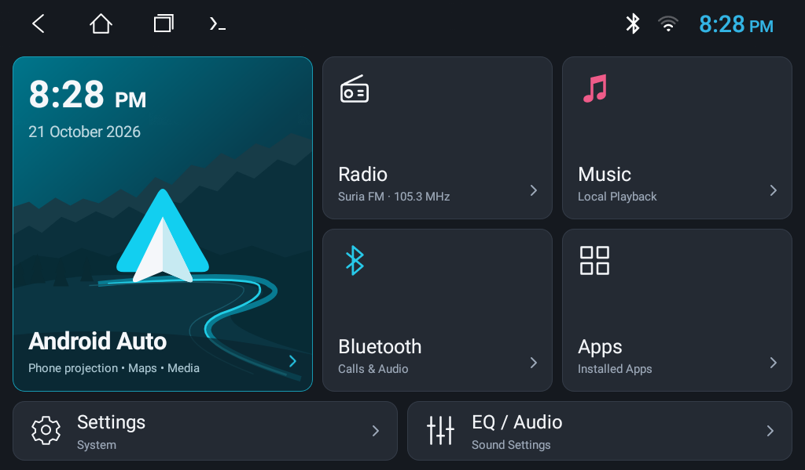

# T3L Revival



*The current T3L Drive 0.3.1 home launcher running on the unit, captured on
21 October 2026: Android Auto projection card, Radio with station names,
Music, Bluetooth, Apps, Settings and EQ tiles.*

Documentation and tooling for the read-only discovery and reversible
optimisation of a TOPWAY/Allwinner T3L Android 8.1 car head unit — replacing a
laggy stock launcher with a lightweight native one, measuring what actually
changed, and keeping every step rollback-safe.

> **Warning:** every device-changing command here was applied on one specific
> unit after review. A differently named or differently built unit is *not* a
> substitute for exact-device evidence. Do not flash, root or debloat a head
> unit based on this repo alone.

## Publish your own project — layman "vibecode" step-by-step

This repo doubles as a worked example: here is exactly how a project folder on
your Linux machine becomes a public GitHub repository, in seven steps. The
full, explained version is in [PUBLISHING.md](PUBLISHING.md).

1. **Keep secrets out first.** Create a `.gitignore` listing anything you
   would never publish — keys, raw dumps, screenshots, build outputs:

   ```gitignore
   evidence/
   .private/
   changes/
   __pycache__/
   *.apk
   ```

2. **Scrub personal traces** from files you *will* publish: Wi-Fi names, LAN
   IPs, real names → placeholders like `<your-ssid>` and `<unit-ip>`.

3. **Add a `LICENSE`** (MIT is the simplest, https://choosealicense.com).

4. **Write a stranger-friendly README**: the first paragraphs should explain
   the project to someone who has never heard of it, plus any warning.

5. **Commit locally and review the staged list:**

   ```sh
   git init -b main
   git add -A
   git status --short      # ← read every line; if a private file
                           #   appears here, fix .gitignore and
                           #   git rm --cached <file> before continuing
   git commit -m "Initial public release"
   ```

6. **Create the GitHub repo and push in one command:**

   ```sh
   gh repo create my-repo-name --public --source=. --push
   ```

   If the push complains about SSH keys, switch GitHub CLI to HTTPS once:

   ```sh
   gh config set git_protocol https
   gh auth setup-git
   git remote set-url origin https://github.com/<your-username>/my-repo-name.git
   git push -u origin main
   ```

7. **Review it like a stranger** — open the repo URL in a browser, check the
   README renders, no private file appears, and the license shows.

Future updates are two lines: `git add -A && git commit -m "what changed"`
followed by `git push`. Never skip re-reading `git status --short` first.

## What is and is not in this repo

Published: the discovery reports, package inventory CSVs, and the
[launcher proposal](launcher-proposal/README.md) (native launcher source and
deployment scripts) under the MIT license.

Not published (kept private by `.gitignore`): the timestamped `evidence/`
folders with raw device dumps and copied vendor APKs, the `changes/` journals,
and `.private/` with the launcher signing keys — only the single final
launcher screenshot above was copied out as `screenshots/`. Repo readers
can regenerate their own evidence with `collect-readonly.py`.

## Current state — approved launcher optimisation applied

**T3L Drive 0.3.1 is installed/default HOME; Theme is now uninstalled for user 0,
including its user data—not merely disabled.** Headunit Reloaded is preserved.
Standby settings were not changed. The factory ROM copy was not erased.
See [current removal scope and recovery limits](theme-removal.md),
[current 75-package inventory](package-inventory-current.csv), and
[earlier launcher optimisation/measurements](optimization-report.md).
The original reports/75-package CSV below are the discovery baseline; the
[initial post-change inventory](package-inventory-after.csv) contains 76 packages
and records the earlier disabled-Theme state, before the subsequent uninstall.

## Reports

- [Hardware and security](hardware-report.md)
- [Memory and thermal observations](memory-report.md)
- [75-package inventory](package-inventory.csv)
- [Conditional debloat proposal](debloat-proposal.md)
- [Startup, standby and launcher proposal](startup-analysis.md)
- [FM radio and vendor dependencies](radio-investigation.md)
- [Recovery gates and rollback proposals](recovery-plan.md)
- [Native launcher source, build and deployment](launcher-proposal/README.md)

Evidence folders are private and timestamped. The initial blocked reports are
retained in `archive/preconnection/` as historical notes, not current findings.

## Reproduce passive collection

Confirm the intended unit's current IP/identity first; the address may change.
These commands operate on an already authorised device, copy host evidence and
perform only diagnostic queries. Dumps themselves create transient workload
and logs; they are not zero-impact idle benchmarks.

```sh
python3 collect-readonly.py --serial <unit-ip>:5555
```

The script never invokes `su`, changes permissions/settings, sends vehicle
commands, launches activities, clears logs or disables packages. Unsupported
and permission-denied queries are recorded. Some optional dumps can be slow;
do not interpret failures as absent features or retry with elevated privileges.
Copying the ten selected APKs was a separate read-only host-copy step, recorded
in the first evidence run's `apks/pull-manifest.json`.

Offline analysis/generation (no device interaction):

```sh
python3 analyse-apks.py evidence/20261021T062836.681052Z/apks
python3 generate-inventory.py evidence/20261021T062836.681052Z
python3 -m unittest -v test_reports
python3 -m unittest -v test_optimization
python3 -m unittest -v test_theme_removal
```

Only the named launcher installation/HOME/stock-disable operations were approved
and applied. Optional printing or unrelated debloat was **not** applied.
Rollback commands are deliberate device changes. No firmware/MCU/CAN changes are proposed. Never use a
similarly named T3L unit's firmware as a substitute for exact-device evidence.

Six baseline offline checks cover report presence, CSV classification/baseline states,
copied APK hashes, radio evidence, binary-XML string lengths and launcher
manifest safety. Five additional post-change checks verify HOME/stock state,
unchanged settings, protected packages, build/source hashes and the recovery
route. Three further checks validate the subsequent Theme uninstall, preserved
HUR/standby and current launcher build. **All 14 passed.** These offline tests do not themselves launch apps or
validate vehicle functions; actual compilation, signing, installation and UI
checks are recorded separately in the optimisation report and journals.
The interrupted `20261021T063740.413028Z` attempt has its own note
and is not treated as a completed evidence run.

## License

[MIT](LICENSE). Placeholders such as `<unit-ip>` and `<your-ssid>` in the docs
are yours to fill in when reproducing the collection.
